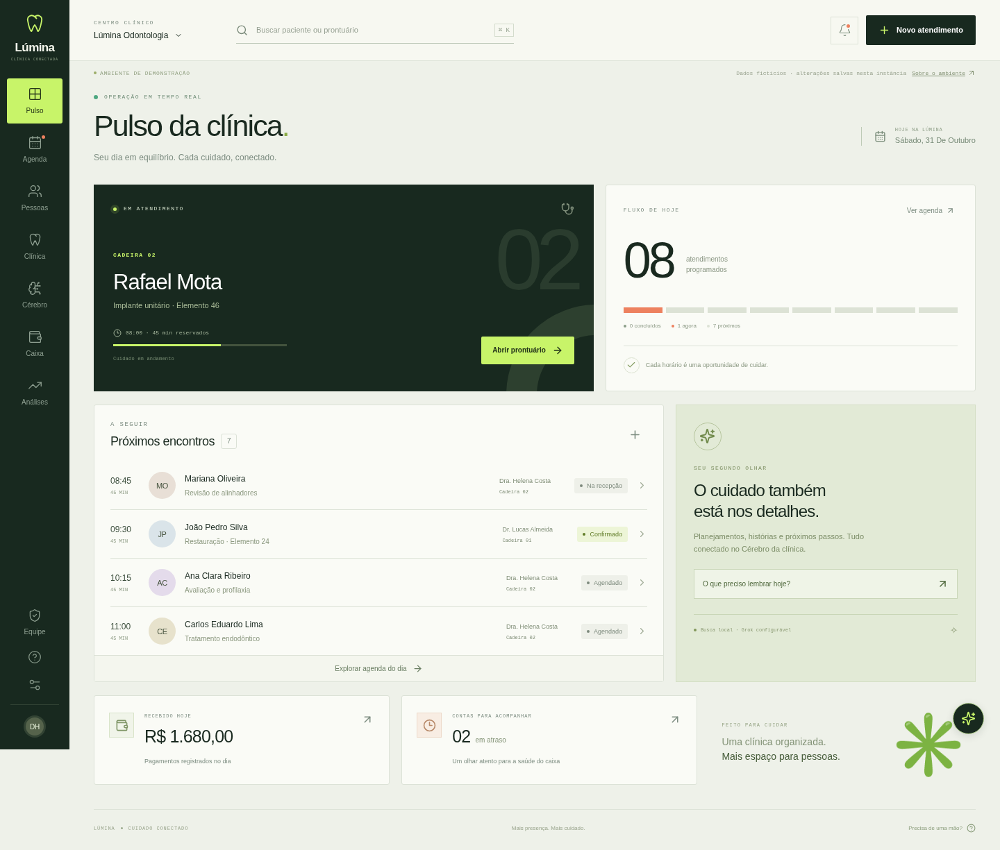

# Lúmina · Gestão odontológica

Primeira versão funcional de uma clínica odontológica com painel, pacientes, agenda diária, odontograma FDI, planejamento, evolução, financeiro, autorização de profissionais e Cérebro compatível com Obsidian. Interface em português, inspirada na referência visual fornecida.



## Executar a demonstração

Requer **Node.js 24** e npm. Na raiz do repositório:

```bash
npm ci
npm run dev
```

Abra o endereço mostrado pelo Next.js. Sem configuração de Supabase, o desenvolvimento usa uma clínica fictícia e SQLite em `.data/clinic.sqlite`. A interface identifica a demonstração. Os registros persistem entre reinicializações locais. Não coloque dados reais nesse modo: ele não exige login e utiliza uma conta administrativa fictícia.

Para verificar a compilação de produção com os mesmos dados fictícios:

```bash
npm run build
DEMO_MODE=true npm start
```

`DEMO_MODE=true` serve somente para demonstração. Em produção, a aplicação não ativa a demonstração automaticamente se faltar o Supabase.

## O que está implementado

- Painel com atendimento atual, agenda, alertas e indicadores financeiros.
- Cadastro e busca de pacientes sem CPF, anamnese e identificação por ID interno.
- Agenda diária, duração, cadeira, profissional, estados do atendimento e verificação de conflitos.
- Odontograma FDI com registro de condição, face, situação, autoria e histórico.
- Planos de tratamento com prioridade, valores e estados; evoluções e retornos recomendados.
- Cobranças, vencimentos, pagamentos parciais, formas de pagamento, despesas e saldo calculado em centavos. Reenvio do mesmo pagamento não duplica o recebimento.
- Perfis de administrador, dentista e recepção; aprovação e suspensão pelo administrador. Permissões verificadas no servidor.
- Notas clínicas, busca documental com fontes e exportação de vault ZIP para o Obsidian.
- Integração de chat com Grok configurável, sem expor a chave ao navegador. Débitos e retornos atrasados são consultados de forma determinística.

## Configurar dados reais no Supabase

Esta versão atende **uma clínica por projeto Supabase**. Use um projeto dedicado. O backend acessa um documento JSONB versionado em `clinic_state`, com controle de concorrência, e perfis separados em `profiles`. A autorização é aplicada pelo backend; as tabelas clínicas não são expostas diretamente ao navegador. A modelagem relacional e os índices por entidade podem ser ampliados conforme o volume crescer.

1. Crie um projeto Supabase e execute [supabase/migrations/001_clinic.sql](supabase/migrations/001_clinic.sql) no SQL Editor antes de criar usuários.
2. Configure o Site URL e os URLs de redirecionamento do Supabase Auth para o domínio da aplicação. Ative a confirmação de e-mail conforme a política da clínica.
3. Copie `.env.example` para `.env.local` e preencha as variáveis no seu computador, ou use o painel seguro do provedor de hospedagem:

   ```dotenv
   DEMO_MODE=false
   SUPABASE_URL=https://SEU-PROJETO.supabase.co
   SUPABASE_ANON_KEY=SUA_CHAVE_ANON
   SUPABASE_SERVICE_ROLE_KEY=SUA_CHAVE_SERVICE_ROLE
   APP_URL=https://SEU-DOMINIO
   ```

   A chave `service_role` deve existir apenas no servidor. Nunca use prefixo `NEXT_PUBLIC_` para ela nem faça commit do arquivo `.env.local`.

4. Inicie a aplicação, solicite o cadastro da primeira conta e confirme o e-mail. Toda conta nova recebe o estado **pendente**; o cliente não pode escolher privilégios administrativos.
5. No painel de usuários do Supabase, copie o UUID dessa conta e execute no SQL Editor, substituindo o placeholder:

   ```sql
   update public.profiles
   set role = 'admin', status = 'active', finance = true
   where id = 'UUID-REAL-DA-PRIMEIRA-CONTA';
   ```

6. Entre novamente na aplicação. Autorize os demais profissionais em **Equipe**. O banco de produção começa vazio, sem pacientes fictícios.

O cookie de sessão é HttpOnly. Nesta versão, ao expirar a sessão, o usuário precisa entrar novamente; renovação automática e recuperação de senha pela interface ainda não foram implementadas. Suspensão e mudança de permissão são conferidas novamente no servidor a cada operação.

## Publicar no Render

O arquivo [render.yaml](render.yaml) descreve um serviço Node no plano gratuito. Ele não publica nada por si só.

1. Envie o código para um repositório GitHub e conecte-o ao Render usando **Blueprint**.
2. Preencha no painel as três variáveis do Supabase e `APP_URL` com o domínio final do serviço. Mantenha `DEMO_MODE=false`.
3. Configure opcionalmente a xAI conforme a seção seguinte e faça o deploy.
4. Verifique `/api/health`, entre com o administrador e teste um cadastro, um agendamento e um pagamento antes de usar a clínica.

O build executa `npm ci --include=dev && npm run build`; o serviço inicia com `npm start` e respeita a porta definida pelo Render. A verificação de saúde consulta o armazenamento, sem retornar dados clínicos.

O sistema de arquivos gratuito do Render é efêmero. **Dados reais devem permanecer no Supabase**, nunca no SQLite local. O ZIP do Obsidian é gerado em memória e não exige disco persistente. Os limites e as condições dos planos gratuitos podem mudar; o Render pode suspender o serviço por inatividade e o Supabase pode pausar projetos conforme suas regras. Defina uma rotina de backup externa e teste a restauração; o vault exportado não é um backup completo do banco.

## Grok e Obsidian

A pesquisa documental e os cálculos financeiros funcionam sem a xAI. Para habilitar interpretação por IA, configure no servidor:

```dotenv
XAI_API_KEY=SUA_CHAVE_PRIVADA
XAI_MODEL=MODELO_DE_CHAT_HABILITADO_NA_SUA_CONTA
```

Consulte os modelos e a cobrança na [documentação da xAI](https://docs.x.ai/docs/models). O backend usa `https://api.x.ai/v1/chat/completions`; permita o domínio `api.x.ai` quando a hospedagem tiver restrições de saída. Não há chamada real validada contra a xAI sem credenciais. Em ambientes de nuvem que fornecem `HTTP_PROXY`/`HTTPS_PROXY`, inicie o Node 24 com `NODE_USE_ENV_PROXY=1` para as chamadas do Supabase e da xAI respeitarem o proxy configurado, mantendo a verificação TLS ativa.

O assistente recupera somente dados autorizados e mostra as fontes. Sem chave, a interface identifica **busca documental local**, sem fingir uma resposta do Grok. A IA não altera o prontuário, não executa comandos nem realiza pesquisa externa.

Em **Cérebro**, exporte o vault ZIP, extraia-o e abra a pasta no Obsidian. Os arquivos são uma cópia pontual: não há sincronização automática nem importação de edições externas nesta versão. Veja [docs/obsidian.md](docs/obsidian.md).

## Verificação e estrutura

```bash
npm run typecheck
npm test
npm run build
```

Os testes de domínio exercitam isolamento de pacientes, permissões, conflitos de agenda, histórico clínico, pagamentos parciais, idempotência e persistência. Os testes do Cérebro verificam busca, cálculos e exportação autorizada. Para executar os testes de navegador, inicie a demonstração em outro terminal, instale Chromium e execute `npm run test:e2e`. A configuração usa `/usr/bin/chromium`; defina `CHROMIUM_PATH` se o executável estiver em outro local. Os testes utilizam somente registros fictícios e adicionam dados à demonstração.

```text
src/app/                  Rotas Next.js e APIs
src/components/           Interface da clínica
src/lib/types.ts          Contratos compartilhados
src/lib/server/           Regras, autorização e armazenamento
src/lib/knowledge.ts      Busca documental e geração do vault
supabase/migrations/      Estrutura e políticas do banco
tests/                   Testes de domínio e persistência
docs/                    Documentação das integrações
```

## Limites desta primeira versão

A base está preparada para evolução, mas ainda não inclui anexos/radiografias, agenda semanal ou mensal, comissões, estornos e conciliação, assinatura de documentos, notificações por WhatsApp/e-mail ou sincronização bidirecional do Obsidian. O odontograma registra dados clínicos e histórico; não substitui avaliação odontológica. A integração Supabase/xAI e a publicação precisam ser validadas na conta de destino.

Código e documentação podem ficar no GitHub. Chaves, banco de dados e vaults reais de pacientes devem permanecer fora do repositório público. A ausência de CPF não elimina a necessidade de autorização para prontuários.
